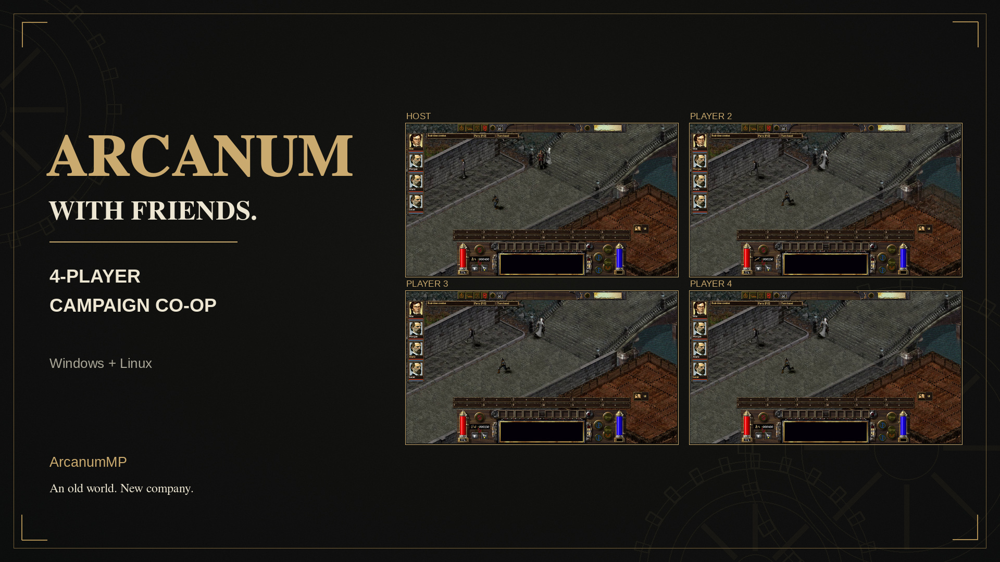

# ArcanumMP

**Arcanum's original campaign, with four-player LAN co-op and a customizable UI.**

Native Linux and Windows executables support cross-play. Each player controls
their own character while the host runs the shared campaign. The new
playability tools also support single-player use.

[Website & trailer](https://panbartosz.github.io/ArcanumMP/) ·
[Download for Windows](https://github.com/PanBartosz/ArcanumMP/releases/download/v0.2.3/ArcanumMP-v0.2.3-Windows-x86_64.zip) ·
[Download for Linux](https://github.com/PanBartosz/ArcanumMP/releases/download/v0.2.3/ArcanumMP-v0.2.3-Linux-x86_64.tar.gz)



*Staged development gameplay from four native engines connected over TCP.
[Showcase details and credits](docs/SHOWCASE.md).*

[Get started](docs/INSTALL.md) · [Player guide](docs/PLAYER_GUIDE.md) ·
[Build from source](docs/BUILDING.md) · [Current status](docs/STATUS.md) ·
[Documentation](docs/README.md)

## Features

- **Campaign co-op:** main-menu host/join, character creation and starting
  equipment, party chat, persistent ownership, shared dialogue, travel and saves.
- **Combat together:** real-time and turn-based combat, spells, skills, loot,
  followers, visible initiative and clickable portraits for targeting.
- **Make the interface yours:** movable/resizable panels, saved layouts,
  individual transparency, themed frames/icons and a visible combat-log toggle.
- **Modern playability:** shared combat history, inventory/action search,
  equipment comparisons, junk marking/sales, extra action rows, quest pins and
  personal notes, crafting help, interaction labels, previews and party pings.
- **Display and controls:** mouse-wheel zoom, middle-button camera panning,
  widescreen/classic presentation, UI/text sizing, remappable commands,
  auto-pause choices and configurable walk/run approaches.
- **Keep your campaign:** named saves, coordinated quick saves/loads, recovery
  checkpoints and reserved character ownership when reconnecting.
- **Play in your own language:** independent English/Polish selection, including
  mixed-language parties. [Polish setup without Python](docs/LOCALIZATION.md#simple-setup--no-python).
- **Loot feedback:** empty bodies and containers show **Empty / Pusto** on hover.

See the [feature inventory](docs/FEATURES.md) and [changelog](CHANGELOG.md).

## Play

Every player needs their own Arcanum installation, matching game data/patches
and the same ArcanumMP build. Delivery is a drop-in archive; original game data
is not included in this repository or its builds.

1. Close the game and copy the archive's **`bin/` contents** into a writable
   Arcanum folder. Keep `lib/` on Linux and the supplied DLLs on Windows.
2. Launch `arcanum-mp` or `arcanum-mp.exe`, then choose **Multiplayer**.
   The game checks its content in the background on first use.
3. One player hosts. Others join through LAN discovery or the host's IPv4
   address. Defaults: TCP **35741**, discovery UDP **35740**.
4. Select or create characters, mark **Ready**, and let the host start the
   campaign. **F12** opens party chat and shared controls during play.

When updating, preserve `arcmp-player.id`, saves, character drafts and your
`arcmp-*.cfg` settings. Your player identity binds you to your saved character.
[Installation and updating](docs/INSTALL.md) explains files and content checks;
the [player guide](docs/PLAYER_GUIDE.md) covers play, saving and reconnection.

## Useful controls

These are defaults; playability commands can be rebound in **B → Settings**.

| Action | Control |
| --- | --- |
| Party chat, votes, pause and shared controls | F12 |
| Combat log | F11 or the journal-and-sword button |
| Items, actions, quests, crafting and settings | B |
| Move/resize custom panels | UI button beside the log toggle |
| Individual panel transparency | B → Settings |
| Extra action rows | Grave / backtick |
| Interaction labels / temporary party ping | Left Alt / Backslash |
| Zoom / pan the world | Mouse wheel / middle-button drag |
| Shared quick save / propose quick load | F9 / F10 |
| Widescreen, UI size and interaction speed | Options → Video |

Widescreen and UI-size changes apply after restart. See
[HUD and portrait controls](docs/PROTOCOL58_FEATURES.md) and
[playability tools](docs/PROTOCOL57_FEATURES.md) for the full options.

## Compatibility

**Latest release: v0.2.3.** All players should use matching mod builds
and game data. Keep your saves, player identity and settings when updating.
The prebuilt Linux executable requires glibc 2.44 or newer; older distributions
can use the [source build](docs/BUILDING.md). Both bundles target x86-64.

Names and chat currently use printable ASCII. The host needs to stay in the
session; a running world does not transfer automatically to a new host.
For remote play, use a reachable host address or a VPN that connects your party
into a virtual LAN. Report reproducible problems through
[GitHub Issues](https://github.com/PanBartosz/ArcanumMP/issues).

## Develop

Start with [building](docs/BUILDING.md) and [contributing](CONTRIBUTING.md).
Session/state tests can be built without game assets or graphics libraries:

```sh
cmake -S . -B build/net -G Ninja -DARCMP_BUILD_GAME=OFF -DCMAKE_BUILD_TYPE=Debug
cmake --build build/net --parallel
ctest --test-dir build/net --output-on-failure
```

Native integration tools use separate writable runtimes and locally owned game
data. Builds, profiles, saves, diagnostic evidence and release archives are
ignored by Git. See [repository maintenance](docs/MAINTENANCE.md) and
[release preparation](docs/RELEASING.md) before publishing artifacts.

## Attribution and license

ArcanumMP is a modified fork of
[Arcanum Community Edition](https://github.com/alexbatalov/arcanum-ce), imported
from commit `a7ff41b300ef712f0e7d088183a3d08957110cdd`. The engine and this
project's modifications use the [Sustainable Use License](LICENSE.md).
Dependency licenses and original notices are retained; see [NOTICE.md](NOTICE.md).
Arcanum's original game files remain separate and are required to play.
