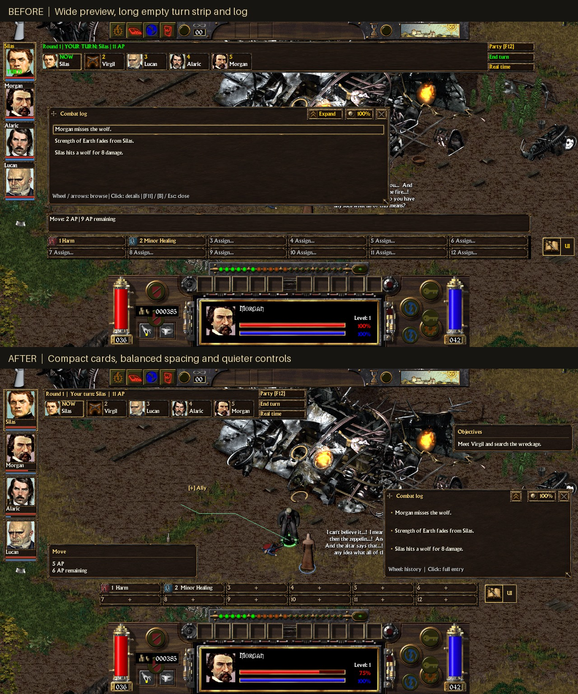

# UI polish — 2026-10-30

This pass refines the added interface using the existing brass, iron and leather
artwork. It keeps protocol 59 and existing saves/settings.

These are staged native engine frames, with prepared names, actions, party stats
and log entries for visual review. They are not a new multiplayer or campaign
acceptance run. The original game artwork remains visible for comparison.

## What changed and why

The previous preview, turn strip and action rows stretched across most of the
screen. Short messages sat in long empty panels, while prominent gold outlines
and bright turn labels competed with the original HUD.

- **Combat preview and hover help:** compact cards with a distinct heading,
  subtle divider, padded body and measured wrapping. AP cost and remaining AP
  occupy separate lines. Party hover cards anchor beside the portraits;
  turn-card help opens below the turn strip. The pause notice uses the same
  treatment. Older undersized preview/pause placements gain enough height to
  show their contents.
- **Turn order:** a bounded, roster-sized default instead of a screen-wide
  strip. Warm headings and the current portrait's bezel identify the active
  actor; neon text no longer covers faces. Paging, targeting and combat controls
  retain their behavior.
- **Party portraits:** names below the faces, recessed health/fatigue tracks,
  existing condition badges and quieter labels. Long names end in an ellipsis;
  hover help retains the full name and status information.
- **Combat log:** a narrower default near the lower right, wrapped entries,
  shorter footer and compact window controls. Clicking an entry opens its full
  details. Defaults leave the native AP strip clear and account for objectives
  and extra action rows.
- **Extra actions:** bounded rows, native icons, quiet empty slots and hover
  explanations. Cramped layouts use icons with small slot numbers; wider slots
  retain labels and ellipses. At short/narrow resolutions the rows leave space
  for the log alongside them.
- **Tools and objectives:** contextual window titles, compact header controls,
  subtle list selection, inset descriptions and less wasted space in Settings
  and note-only objective panels. Window controls have named hover help.

Representative defaults at 1280×720 with 100% text:

| Element | Before | After |
| --- | --- | --- |
| Combat preview | 1076×46 | 336×79 |
| Turn strip, five combatants | 1098×69 | 586×69 |
| Compact combat log | 760×220 | 420×200 |

## Existing layouts

Saved custom positions, sizes and transparency remain in `arcmp-ui.cfg`.
To adopt all new defaults, use **B → Settings → Reset HUD positions and sizes**.
That leaves transparency and other preferences intact. Existing move/resize
handles remain available; compact rows show full action names on hover.

## Verification

Native game frames were inspected at 800×600, 1280×720 and 1920×1080, each with
100% and 150% text. Geometry checks confirm the reviewed defaults keep party
and turn panels apart, separate preview/actions/log/objectives, and leave the
native AP area clear. The review also covers the five expanded tool tabs,
party hover help, off-turn notices and the pause card.

Real mouse handlers were exercised for compact-entry expansion, title dragging
and corner resizing. Opacity was checked against the native window, geometry
survived reopening, and a custom preview placement was retained. The 1280×720
ASan/UBSan UI run passed; leak detection was disabled under the debugger.
The optimized Linux build and Windows cross-build succeed. This pass's
runtime rendering checks are Linux-native; previous Wine/network/campaign
evidence is retained rather than repeated.

Local captures, geometry/control reports and binary hashes are preserved under
`evidence/ui-polish/`, summarized in `acceptance.json`. Reproduce the scoped
review with `tools/benchmark_qol.py --ui-review --require-clean` and an explicit
binary/output path. `tools/ui_polish_stage.py` supplies the staged composition;
it does not route campaign quests.
